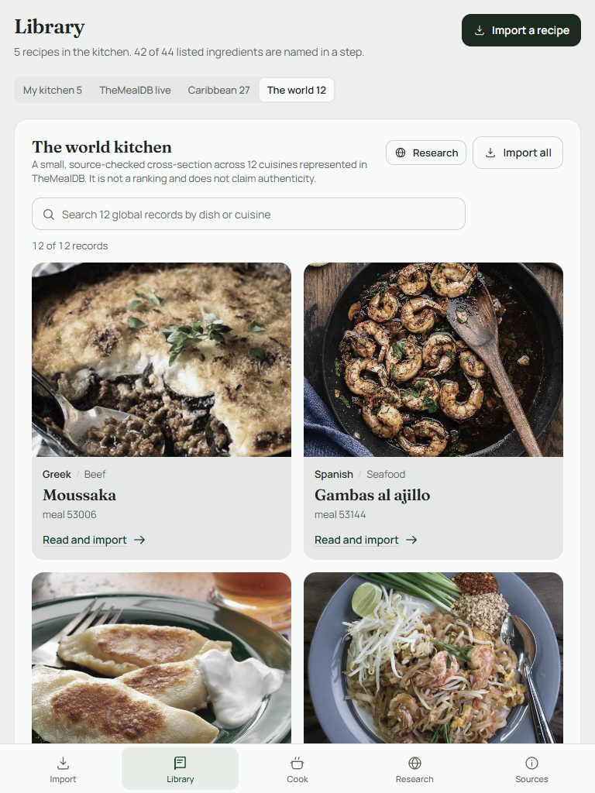
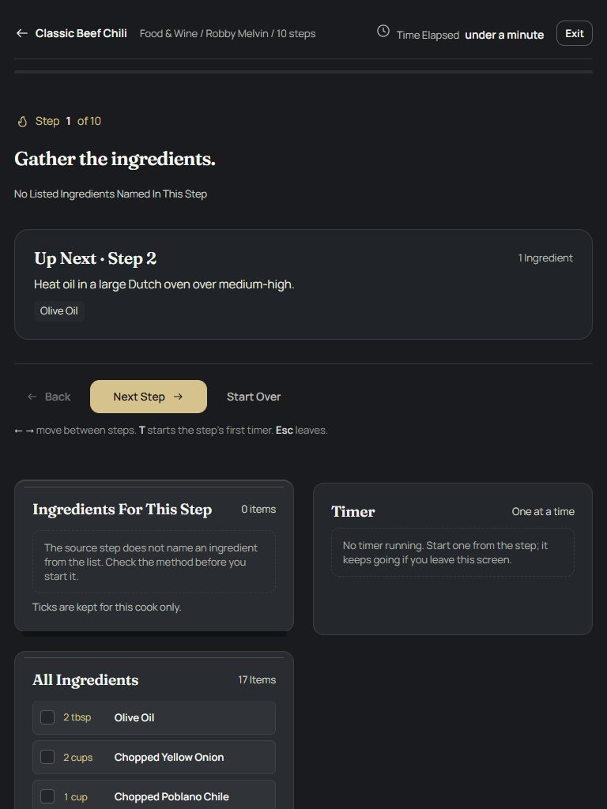

# Mise

Mise is a source-attributed recipe book with a cook mode built to be read at arm's length. It runs as a plain offline web app and ships to Android as a native WebView wrapper for phones, foldables, and tablets.

The app keeps 253 recipe records in the bundled library:

- 130 world recipes across 23 cuisines
- 55 African recipes (39 from TheMealDB, 16 from publisher recipe cards)
- 63 Caribbean recipes (27 from TheMealDB, 36 from publisher recipe cards)
- 5 bundled sample recipes

Publisher recipe text is preserved as published. Missing yields, times, or units stay visibly missing rather than being guessed. See [assets/credits.md](assets/credits.md) for every source and the collection policy.

## What is in the app

- **Library and World browsing** across the bundled collection, with search and cuisine filters.
- **Africa and Caribbean tabs** that keep multi-source coverage visible instead of reducing a region to one database's results.
- **Cook mode** that shows the full instruction text, one active step at a time, with inline timers and a persistent timer dock.
- **Offline recipe storage** in `localStorage`, so imported and saved recipes survive restarts.
- **Live TheMealDB search** for recipes outside the bundled collection.
- **Tablet layouts** driven by the existing responsive CSS, with unrestricted orientation and multi-window resizing in Android.

| Tablet library | Tablet cook mode |
| --- | --- |
|  |  |

## Run the web app

There is no build step. Open `index.html` directly, or serve the folder:

```powershell
node tools/serve.mjs
# http://127.0.0.1:4173/index.html
```

`tools/serve.mjs` is intentionally tiny; any static file server works.

## Build the Android app

Requirements: JDK 17 or newer, Android SDK platform 36, and the Gradle wrapper in `android/`.

```powershell
cd android
.\gradlew.bat :app:assembleDebug
# android/app/build/outputs/apk/debug/app-debug.apk
```

The Gradle build copies `index.html`, `css/`, `js/`, and `assets/` from the repository root into generated Android assets at build time. There is no second copy of the web source to keep in sync.

Install a debug build on a connected device:

```powershell
adb install -r android\app\build\outputs\apk\debug\app-debug.apk
```

### Tablet support

The manifest declares resizable activity, all screen sizes and densities, no required touchscreen, and unrestricted orientation. Layouts use the web app's responsive breakpoints, and the Android host applies system-bar and display-cutout insets before the WebView is shown. The same APK runs on a phone, a tablet, a foldable, and a Chromebook-class device.

## Releases and OTA updates

Every GitHub release publishes three assets:

| Asset | Purpose |
| --- | --- |
| `mise-<version>.apk` | Signed Android package |
| `mise-web-<webVersionCode>.zip` | Web content for in-app OTA delivery |
| `mise-manifest.json` | Version, checksums, sizes, and release notes |

The app checks:

```text
https://github.com/BadImps/mise/releases/latest/download/mise-manifest.json
```

Content updates download the web zip, verify its SHA-256 and size, unpack it to a staging directory, confirm `index.html` exists, and only then switch the active version. Native updates use Android `DownloadManager`, verify the APK's SHA-256 before opening the system installer, and retain a verified download across process restarts.

Both bundled and OTA content are served through the virtual origin `https://mise.local`. That keeps `localStorage`, browser history, and hash routes stable across content updates.

### Versioning

- `versionCode` and `versionName` identify the Android package.
- `web.versionCode` identifies bundled web content. It defaults to `versionCode`.
- A content-only OTA release keeps the APK version unchanged and raises only the web version. For example, `versionCode=1` with `web_version_code=2`.
- Never reuse a web version that is lower than or equal to the version already active on devices.

The full manifest contract and rollback behavior are documented in [docs/OTA.md](docs/OTA.md).

### Publish a release

1. Open **Actions → Publish Android release → Run workflow**.
2. Enter the tag (`v1.0.0`), version name (`1.0.0`), and version code (`1`).
3. Leave `web_version_code` empty for a normal app release, or set a higher value (for example `2`) for content-only OTA.
4. Add short plain-text OTA notes. They appear in the in-app update dialog.
5. Run the workflow. It verifies the web app, builds and signs the APK, generates the web zip and manifest, verifies the signature, and creates the GitHub release.

The workflow needs four repository secrets:

- `MISE_KEYSTORE_BASE64`
- `MISE_STORE_PASSWORD`
- `MISE_KEY_ALIAS`
- `MISE_KEY_PASSWORD`

The release keystore lives outside this repository. Local release builds read `android/signing/upload-signing.properties`, which is ignored by Git. Release builds fail when that file is missing, so a release cannot be published with a debug key by accident.

## Verify a build locally

```powershell
node tools/verify-web.mjs
cd android
.\gradlew.bat :app:lintDebug :app:assembleDebug
```

`tools/verify-web.mjs` checks local asset references in `index.html` and syntax-checks every JavaScript file without executing it.

## Repository layout

```text
index.html                 web entry point
css/                       app theme and responsive layout
js/                        recipe libraries, parser, cook mode, UI
assets/                    fonts, photographs, attribution
android/                   native WebView host and Gradle project
docs/OTA.md                update manifest and release contract
docs/screenshots/          README images
tools/verify-web.mjs       web smoke checks
tools/make-release.mjs     APK copy, web zip, manifest generation
tools/build-collections.mjs  repeatable recipe library generation
.github/workflows/         debug build and signed release pipelines
```

## Sources and editorial policy

The collection is deliberately multi-source. TheMealDB provides a consistent snapshot for the world and Africa collections, but a zero result in one database is not evidence that a cuisine does not exist. Publisher recipes fill those gaps and keep their own wording and attribution.

Recipe photographs from publishers are not bundled or hot-linked. TheMealDB meal photographs are used with their records. Recipe text remains attributable to its original publisher; Mise does not claim ownership of it.

## Privacy

Mise has no account system, analytics, or advertising SDK. The app requests network access only for live recipe search and update checks. Saved recipes and update state stay in app-private storage on the device.
